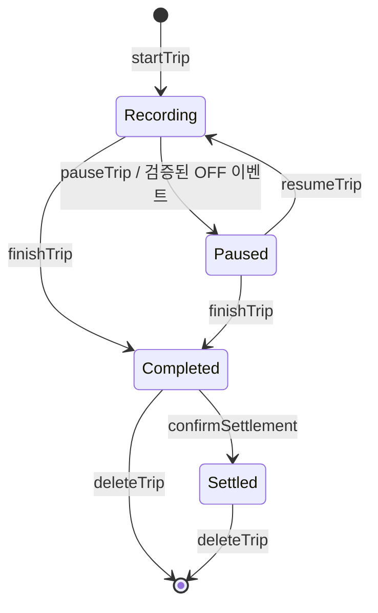
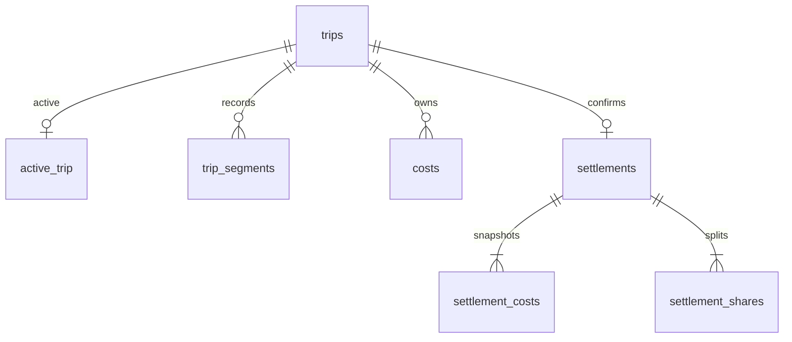

# TAGO HTML 기준 API·함수·테이블 명세 v0.1

작성일: 2026-11-08. 상태(2026-11-09 갱신): 설계 명세이며 **핵심 결제액 흐름만 부분 구현**되었다. 이 명세 전체가 구현된 것은 아니다. Compose 퍼블리싱 완료나 실제 차량 연동 완료를 의미하지 않는다.

**구현 현황 (2026-11-09): 아래 최초 구현 기록에 이어 설정·일시정지·목록 삭제와 전체 QA를 추가했다. 최신 검증은 [전체 연결 검수](full-integration-qa-2026-11-09.md)를 따른다.**

- 구현: 비용 FUEL/PARKING/TOLL/OTHER 등록·수정·삭제·포함 선택, 포함 합계 정산, 주유량 표시, 운전자 포함/제외와 정수 원 나머지 배분, 정산 인원 변경, 미리보기, expectedRevision 기반 확정(제외 비용 포함 스냅샷·표시 이름 고정), 정산 요약 텍스트·QR, 월별 내역과 상태 필터, Room v2(v1 추정 정산은 legacy로 보존), 요청 ID 기반 중복 방지(costs·payment_settlements), 빈 여행 닫기(`discardEmptyTrip`: 진행 중이며 구간·비용·거리가 없는 여행 한 건만 확인 후 삭제, 홈 이동. `meta`·command receipt 없이 tripId만 받고 `Unit`을 반환하며 실패 코드는 TRIP_NOT_EMPTY/TRIP_NOT_FOUND/TRIP_NOT_IN_PROGRESS/TRIP_LOCKED).
- 후속 구현: Room v3 설정·초기화, v4 trip_sessions 기반 수동 일시정지/재개, 완료 여행의 목록 삭제(hidden). PAUSED enum을 추가하지 않고 단일 활성 여행 제약을 유지한다. 확정 원본의 영구 삭제는 제공하지 않는다.
- **미구현 제안**: 차량 PARKED 상태 확인에 의한 편집 차단(VEHICLE_NOT_PARKED), command_receipts 테이블과 ALREADY_APPLIED, 실제 Pleos VehicleDataSource.
- 명세와 다른 구현: UUID 대신 Long 자동증가 ID, 상태명 IN_PROGRESS/FINISHED/SETTLED, active_trip 테이블 대신 trips.activeSlot 유일 인덱스. 차이는 [database.md](database.md)에 기록한다.
- 이 명세의 상세 항목을 구현 여부 확인 없이 완료로 간주하지 않는다. 구현 상태의 기준은 README.md와 실제 코드다.

## 1. 기준과 범위

최신 실행 HTML의 `preview/index.html`, `workflow.js`, `trip-record.js`, `trip-resume.js`, `trip-complete.js`, `refuels.js`, `expenses.js`, `settlement.js`, `settings.js`를 기준으로 한다. 위치: `/Users/choi/Documents/ChatGPT/HD 프로젝트/preview/`. 누적 문서의 옛 설명보다 마지막에 로드되는 화면/이벤트 구현을 우선한다.

**API는 ViewModel이 호출하는 앱 내부 UseCase 계약이다.** 초기 앱은 Kotlin·Room 기반 오프라인 앱이며 HTTP 서버/계정/결제 API는 만들지 않는다. HTTP 경로가 필요한 서버 도입은 별도 범위다. 화면 → ViewModel → UseCase → Repository → Room 순서로 호출한다.

- HTML에서 확인: 여행 시작/중단/복원/완료, 여행별 비용 CRUD, 포함 선택, 인원/운전자 포함 변경, 정산 확정/요약 복사, 여행 삭제, 월별 내역, 설정.
- 신규 설계 제안: 공통 costs 테이블, revision 충돌 방지, 명령 멱등키, 원자적 스냅샷, 명시적 오류 타입. HTML에 이미 구현되어 있다는 뜻이 아니다.
- 차량 SDK 이벤트명·권한·데이터 취득 가능 시점은 미확정이다. 아래 VehicleDataSource는 내부 추상 계약이다.
- 실제 송금·입금 상태, 회원, 서버 동기화, 자동 카드/하이패스 결제 수집은 제외한다.

## 2. 핵심 정책과 기존 문서 차이

| 항목 | 최신 HTML 기준 |
|---|---|
| 여행과 비용 | 여행 1 : 비용 0~N. 주유·주차·톨비·기타를 한 목록에서 관리 |
| 정산 총액 | `included=true`인 실제 결제 금액 합계. 거리÷연비×단가를 더하지 않음 |
| 주유량 | 결제액÷리터당 가격, 소수점 3자리 표시. 정산에 주유량을 다시 곱하지 않음 |
| 운전자 포함 | ON 전체 인원, OFF 운전자 0원/동승자만 분담. 1명은 ON 강제 |
| 확정 | 비용 전체(제외 항목 포함), 인원, 분담액, 표시 이름을 복사하여 고정 |
| 삭제 | 미확정/확정 완료 여행 모두 사용자 확인 후 여행·비용·정산을 함께 삭제 |
| 설정 | 표시 이름, 새 여행의 정산 기본값, 화면 모드. 기존 확정 내역 변경 금지 |
| 등록 후 이동 | 기록에서 진입하면 기록/멈춤 화면, 내역에서 진입하면 내역으로 복귀 |

`planning.md`, `architecture.md`, `database.md`, `testing.md`, `decisions.md`는 2026-11-09에 이 결제액 방식을 현재 제품으로 하여 개정했다. 예상 유류비·fuel_prices·구간별 정산 계산은 이전 설계이며 v1 이력(legacy)으로만 남는다. 이 문서는 후속 구현 기준이며 위 "구현 현황"에 적은 미구현 제안은 여전히 설계 상태다.

## 3. 상태와 사용자 흐름



- 준비 화면 입력은 UI draft. 시작 저장이 성공하면 로고·안전 문구를 3~4초 표시한다. 애니메이션 종료를 DB 저장 시점으로 사용하지 않는다.
- `RECORDING`, `PAUSED`를 활성 상태로 보고 동시에 최대 한 여행만 허용한다.
- 재실행은 활성 여행과 구간·비용을 조회해 복원 화면을 표시한다. 기존 RECORDING 상태를 실제 주행 중이라는 증거로 사용하지 않는다. 차량 상태를 재확인한 뒤 이어간다.
- pause는 종료가 아니다. 정산 가능 상태는 COMPLETED 또는 SETTLED다.
- 거리·비용이 모두 없는 여행은 별도 닫기 확인 후 `discardEmptyTrip`으로 제거한다. 비용만 있는 0km 여행은 완료할 수 있다.
- 비용 작성/수정은 RECORDING/PAUSED/COMPLETED에서 허용하되 차량은 PARKED여야 한다. SETTLED는 읽기 전용이다.
- UI 복귀 대상 `returnTo=TRIP|COST_LIST|SETTLEMENT_DETAIL`은 내비게이션 상태이며 DB 컬럼이 아니다.

## 4. 공통 타입과 입력 검증

| 필드 | 타입 / 규칙 |
|---|---|
| ID | UUID 문자열. 클라이언트 생성, 여행/비용/이벤트별 식별 |
| 시각 | Instant → SQLite INTEGER UTC epoch milliseconds |
| 날짜 | LocalDate → TEXT YYYY-MM-DD. 실제 달력 날짜 검사 |
| 여행 월 | YearMonth. trip_date 기준 조회, 날짜는 여행 시작 지역의 날짜로 고정 |
| 금액 | Kotlin Long / SQLite INTEGER, KRW 정수. 1건 1~10,000,000원 |
| 주유 단가 | BigDecimal / TEXT 정규화 십진 문자열, 1~9,999원/L, 소수 2자리 이하 |
| 여행 이름 | trim, 최대 32자. 빈 값은 ‘새로운 여행’ |
| 인원 | 운전자 포함 1~8명(현재 시안 한도) |
| 주유소 | 선택, trim, 최대 50자 |
| 주차 장소/톨게이트·구간/기타 내용 | 선택, trim, 최대 100자 |
| 표시 이름 | 선택, trim, 최대 20자. 비면 ‘나’ |
| 주유일 | 주유만 사용. 입력하지 않으면 등록 당시 지역 날짜. HTML 고정 날짜를 제품에 이식하지 않음 |
| source | SAMPLE / VEHICLE / MANUAL. 차량 측정값과 사용자 입력을 구분 |
| revision | Long, 저장 변경마다 증가. 자식 비용/구간 변경도 여행 revision 증가 |

Long 합계는 checked-add로 오버플로를 거부한다. 금액/단가에 Double을 쓰지 않는다. liters는 원본 금액과 단가에서 BigDecimal로 계산하며 HALF_UP 3자리 표시는 UI용이다. 미래 날짜 금지 규칙은 HTML에 명시되지 않아 임의로 도입하지 않는다.

```kotlin
sealed interface AppResult<out T> {
    data class Success<T>(val value: T) : AppResult<T>
    data class Failure(val code: ErrorCode, val field: String? = null) : AppResult<Nothing>
}
data class CommandMeta(val requestId: String, val expectedRevision: Long?)
enum class CostKind { FUEL, PARKING, TOLL, OTHER }
data class CostInput(
    val kind: CostKind, val amountWon: Long, val description: String?,
    val unitPriceWonPerLiter: BigDecimal?, val paidOn: LocalDate?
)
```

FUEL은 단가/주유일을 저장하고 description은 주유소다. 다른 종류는 unitPrice/paidOn=null이며 description은 장소/내용이다. UI의 종류 변경은 입력값을 유지하되 저장할 때 종류에 맞는 스키마를 검증한다. 신규 비용은 included=true; 수정은 기존 포함 여부를 보존한다.

## 5. 화면별 API 계약

쓰기 함수는 `suspend … : AppResult<T>`, 읽기 구독은 `Flow<LoadState<T>>`다. LoadState는 Loading/Data/Error를 구분하며 실패를 빈 목록/0원으로 바꾸지 않는다. 아래 meta는 CommandMeta다.

| 화면 / 동작 | 함수와 입력 | 반환 | 조건 / 저장 효과 |
|---|---|---|---|
| 홈 | observeHome() | HomeSummary | 활성 여행, 미정산 목록·건수 |
| 준비 → 시작 | startTrip(name, people, meta) | TripDetail | 활성 여행 없음, PARKED. 여행 및 활성 슬롯 생성 |
| 기록/복원 | observeActiveTrip() | TripDetail? | 구간·비용·최근 저장 시각 포함, 없으면 null |
| 앱 재실행 | restoreSession() | RestoredSession | 활성 여행/설정/차량 UNKNOWN부터 조회. 손상 시 오류 반환 |
| 구간 저장 | recordSegment(tripId, SegmentInput, meta) | Segment | 차량 이벤트 또는 정차 수동 기록; 중복 eventKey 무시 |
| 잠시 멈춤 | pauseTrip(tripId, finalSegment?, meta) | TripDetail | 구간 저장과 PAUSED 전환 한 트랜잭션 |
| 이어가기 | resumeTrip(tripId, meta) | TripDetail | PAUSED 또는 재실행 복원 대상; 새 여행/인트로 생성 안 함 |
| 여행 마치기 | finishTrip(tripId, finalSegment?, meta) | TripDetail | 활성 상태, PARKED. 마지막 구간 저장+종료+활성 슬롯 해제 |
| 빈 여행 닫기 | discardEmptyTrip(tripId, meta) | Unit | 거리/비용 없음 재검사, 활성 슬롯과 빈 여행 삭제 |
| 비용 내역 | observeCosts(tripId) | CostLedger | 전체/포함 합계, 종류별 소계, 목록 |
| 주유·기타 비용 등록 | addCost(tripId, input, meta) | Cost | 검증/편집 가능 상태; 포함 기본 true |
| 비용 수정 | updateCost(tripId, costId, input, meta) | Cost | 소속 검사, included 보존 |
| 비용 포함 선택 | setCostIncluded(tripId, costId, included, meta) | CostLedger | 토글이 아닌 원하는 절대값 전달 |
| 비용 삭제 | deleteCost(tripId, costId, meta) | CostLedger | 확인 후 삭제; 정산 확정 상태 거부 |
| 정산 인원/운전자 | updateSplitPolicy(tripId, people, includeDriver, meta) | SettlementPreview | COMPLETED, 1명일 때 ON 정규화 |
| 정산 미리보기 | previewSettlement(tripId) | SettlementPreview | 저장된 비용/분담 정책으로 계산; tripRevision 반환 |
| 금액 확정 | confirmSettlement(tripId, meta) | SettlementDetail | expectedRevision 필수, COMPLETED, 포함 비용 ≥1 |
| 정산 목록 | observeSettlements() | SettlementList | 미확정/확정 목록과 미확정 합계 |
| 정산 상세 | observeSettlement(tripId) | SettlementDetail | SETTLED면 스냅샷만 읽음 |
| 개인별 명세 | getSettlementShares(tripId) | List<Share> | 미확정은 preview, 확정은 저장 명세 |
| 복사/요약 | buildSettlementSummary(tripId) | String | SETTLED. 저장한 이름·금액으로 생성, 클립보드는 UI 담당 |
| 여행 내역 | observeHistory(month, filter) | HistorySummary | filter ALL/PENDING/SETTLED; 월 여행 건수·거리·확정 건수 |
| 여행 상세 | observeTrip(tripId) | TripDetail | 미존재면 NOT_FOUND |
| 여행 삭제 | deleteTrip(tripId, meta) | Unit | COMPLETED/SETTLED, PARKED, 하위 데이터 일괄 삭제 |
| 설정 읽기 | observeSettings() | UserSettings | 없으면 이름 빈값/운전자 포함/시스템 모드 |
| 설정 저장 | updateSettings(name, defaultIncludeDriver, theme, meta) | UserSettings | PARKED. 기존 여행 분담 정책에는 소급하지 않음 |
| 설정 초기화 | resetSettings(meta) | UserSettings | 설정만 기본값, 여행 삭제 안 함 |

설정 기본값 적용 시점은 HTML의 ‘새로 완료하는 여행’에 맞춰 finishTrip에서 정한다. 시작 시 인원은 저장하되 완료 시 defaultIncludeDriver를 적용하고 이후 여행별 변경값을 유지한다. 명세의 startTrip/resumeTrip 사용자 동작은 정차 상태에서 허용하며 자동 주행 기록 수집과 분리한다.

### 반환 DTO의 필수 필드

- TripDetail: id, name, status, people, includeDriver, vehicleLabel, source, startedAt, endedAt?, lastSavedAt, revision, distanceMeters?, recordedDurationSeconds?, segments[], costs[]. 측정 누락은 null과 quality로 표시한다.
- CostLedger: costs[], count, registeredTotalWon, includedTotalWon, excludedTotalWon, totalsByKind, tripRevision. 종류별 소계는 포함 여부와 무관한 등록액 합계다.
- SettlementPreview: tripId, tripRevision, totalWon, fuelTotalWon, otherTotalWon, includedCount, people, splitPeople, includeDriver, shares[], canConfirm, blockingReason?.
- Share: ordinal(0=운전자), displayName, isDriver, amountWon.
- HistorySummary: month, filter, trips[], monthlyTripCount, monthlyDistanceMeters, monthlySettledCount. 상단 월 통계는 상태 필터와 무관하고 목록만 필터링한다.
- RestoredSession: activeTrip?, settings, requiresResume=true(활성 여행 존재 시), vehicleState, storageHealth. 재시작만으로 새 구간을 만들지 않는다.

## 6. 순수 함수 및 Repository

| 함수 | 책임 |
|---|---|
| validateTripInput / validateCostInput / validateSettings | 입력 범위와 종류별 필수값 검사 |
| calculateFuelLiters(amount, unitPrice) | BigDecimal 나눗셈과 표시 반올림 |
| summarizeCosts(costs) | 전체·포함·종류별 합계 |
| calculateShares(totalWon, people, includeDriver) | 균등 분담 및 순서대로 나머지 배분 |
| buildSettlementSnapshot(trip, costs, driverName) | 변경 가능한 원본과 분리된 사본 |
| deriveTripMetrics(segments) | 검증된 구간 합산, 품질/누락 전파 |
| canEditTrip(status, vehicleState) | 상태 정책. UI 비활성뿐 아니라 UseCase에서도 검사 |
| formatSettlementSummary(snapshot) | 고정된 데이터만으로 텍스트 작성 |

Repository는 TripRepository(조회/여행 트랜잭션), CostRepository(비용/합계), SettlementRepository(원자적 확정/조회), SettingsRepository(설정)를 둔다. 공통 TransactionRunner로 여러 DAO 쓰기를 묶는다. UI에서 DAO를 직접 호출하지 않는다.

VehicleDataSource: `observeVehicleState(): Flow<VehicleState>`, `observeRecordingEvents(): Flow<RecordingEvent>`, `readSnapshot(): AppResult<VehicleSnapshot>`. 내부 타입의 state는 PARKED/DRIVING/DISCONNECTED/UNKNOWN. SAMPLE 데이터 소스도 같은 계약을 사용하며 운영 차량 값으로 오인하지 않도록 source를 유지한다.

## 7. 테이블 설계 (Room / SQLite 제안)

별도 users/vehicles 서버 테이블은 필요 없다. 차량 표시는 여행 시작 당시 라벨로 보존한다. 별도 참여자 편집 UI가 없으므로 현재는 여행의 people와 확정된 shares 순번으로 충분하다.



공통: ID TEXT PK, Bool INTEGER 0/1, enum TEXT, UTC 시각 INTEGER. 모든 FK는 ON DELETE CASCADE. 아래 NN은 NOT NULL이다.

### trips

| 컬럼 | 타입/제약 | 설명 |
|---|---|---|
| id | TEXT PK | 여행 UUID |
| name | TEXT NN | 1~32자, 기본명 정규화 후 저장 |
| status | TEXT NN | RECORDING/PAUSED/COMPLETED/SETTLED |
| trip_date / zone_id | TEXT NN | 시작일/시간대. 월 조회 기준 |
| started_at / ended_at | INTEGER NN / nullable | 종료 전 ended_at null |
| people / include_driver | INTEGER NN | 1~8 / Bool, 1명은 true |
| vehicle_label / source | TEXT NN | 차량 표시 이름 / 데이터 출처 |
| revision | INTEGER NN default 0 | 비용·정책·구간 변경에도 증가 |
| created_at / updated_at | INTEGER NN | 저장 시각 |

인덱스 `(trip_date DESC, id)`, `(status, trip_date DESC)`. 거리/시간은 구간에서 산출하여 이중 저장 불일치를 피한다.

### active_trip

`singleton_id INTEGER PK CHECK(singleton_id=1)`, `trip_id TEXT NN UNIQUE FK trips(id)`. 활성 여행 한 건 제약. 시작/종료/빈 여행 닫기와 같은 트랜잭션에서 변경한다.

### trip_segments

| 컬럼 | 타입/제약 | 설명 |
|---|---|---|
| id / trip_id | TEXT PK / NN FK | 소속 여행 |
| ordinal | INTEGER NN | 여행 내 순번, UNIQUE(trip_id, ordinal) |
| event_key | TEXT NN | 원천 이벤트 식별, UNIQUE(trip_id, event_key) |
| started_at / ended_at | INTEGER NN | ended_at ≥ started_at |
| distance_meters / recorded_seconds | INTEGER nullable | 유효할 때만 비음수 값 저장 |
| from_label / to_label | TEXT nullable | 출발/경유지 등 표시용 |
| odometer_start / odometer_end | TEXT nullable | 단위 확인된 원본 십진값 |
| odometer_unit | TEXT nullable | 원본 단위 |
| efficiency_raw / efficiency_unit / aggregation_scope | TEXT nullable | 차량 연비 원본/단위/집계 기준. 현재 정산 계산에는 미사용 |
| source / quality | TEXT NN | SAMPLE/VEHICLE/MANUAL, VALID/MISSING/INVALID |

인덱스 trip_id. 구간 중복/겹침·감소한 누적거리 검사. 조회 실패를 0으로 기록하지 않는다. OFF 직후 수집 가능 여부는 실제 SDK 검증 대상이다.

### costs — 주유와 기타 비용 공통

| 컬럼 | 타입/제약 | 설명 |
|---|---|---|
| id / trip_id | TEXT PK / NN FK | 비용 UUID/여행 |
| kind | TEXT NN | FUEL/PARKING/TOLL/OTHER |
| amount_won | INTEGER NN | 1~10,000,000 |
| description | TEXT nullable | 주유소≤50자, 기타 장소/내용≤100자 |
| unit_price | TEXT nullable | FUEL 필수, 기타 null |
| paid_on | TEXT nullable | FUEL 필수, 기타 null |
| included | INTEGER NN default 1 | 정산 포함 여부 |
| created_at / updated_at | INTEGER NN | 생성/수정 시각 |

인덱스 `(trip_id, created_at, id)`, `(trip_id, included)`. 주유량은 파생값이므로 저장하지 않는다. kind별 null 제약과 금액 제약을 DAO 진입 전 검증하고 가능한 CHECK 제약으로 보강한다. 별도 fuel_prices/refuels 테이블은 최신 흐름에 필요 없다.

### settlements

`id TEXT PK`, `trip_id TEXT NN UNIQUE FK`, `trip_name TEXT NN`, `trip_date TEXT NN`, `distance_meters INTEGER nullable`, `recorded_seconds INTEGER nullable`, `total_won INTEGER NN`, `fuel_total_won INTEGER NN`, `other_total_won INTEGER NN`, `people INTEGER NN`, `include_driver INTEGER NN`, `split_people INTEGER NN`, `source_trip_revision INTEGER NN`, `calculation_version TEXT NN ('payments-v1')`, `confirmed_at INTEGER NN`.

금액/인원은 스냅샷 생성 당시 값이다. 합계와 자식의 일치 여부를 확정 트랜잭션에서 검사한다. 확정 이후 수정 API는 제공하지 않는다.

### settlement_costs

`id TEXT PK`, `settlement_id TEXT NN FK`, `original_cost_id TEXT NN`, `kind TEXT NN`, `amount_won INTEGER NN`, `description TEXT nullable`, `unit_price TEXT nullable`, `paid_on TEXT nullable`, `included INTEGER NN`, `ordinal INTEGER NN`.

UNIQUE(settlement_id, original_cost_id), UNIQUE(settlement_id, ordinal). 원본 비용 id는 추적용 값이며 costs에 FK를 걸지 않는다. 모든 비용의 복사본을 보존한다.

### settlement_shares

`settlement_id TEXT NN FK`, `ordinal INTEGER NN`, `display_name TEXT NN`, `is_driver INTEGER NN`, `amount_won INTEGER NN CHECK(amount_won>=0)`. 복합 PK(settlement_id, ordinal). 운전자 ordinal=0은 제외해도 0원 행으로 보존한다.

### app_settings

`singleton_id INTEGER PK CHECK(singleton_id=1)`, `display_name TEXT NN default ''`, `default_include_driver INTEGER NN default 1`, `theme TEXT NN default 'SYSTEM'`, `revision INTEGER NN`, `updated_at INTEGER NN`. theme=SYSTEM/LIGHT/DARK. 계정 정보가 아니다.

### command_receipts — 멱등성 보조

`request_id TEXT PK`, `operation TEXT NN`, `payload_hash TEXT NN`, `result_ref TEXT nullable`, `completed_at INTEGER NN`.

같은 키/같은 payload는 중복 변경 없이 기존 참조 결과를 반환한다. 같은 키/다른 payload는 CONFLICT. 삭제는 성공 영수증만 남기고 이름·내용을 넣지 않는다. 쓰기와 영수증 저장은 한 트랜잭션이다. 보존 기간은 초기 버전 무기한(개인 상세 없음) 제안이며 운영 용량 기준은 추후 결정한다. 삭제 후 오래된 요청의 결과 참조가 사라졌으면 ALREADY_APPLIED를 반환하고 재생성하지 않는다.

## 8. 계산·트랜잭션 규칙

```text
includedCosts = costs.filter(included)
total = checkedSum(includedCosts.amountWon)
splitPeople = people - (includeDriver ? 0 : 1)
base = total / splitPeople          // 정수 나눗셈
remainder = total % splitPeople
대상 순서 = [운전자, 참여자2, ...]에서 제외 운전자를 제거
대상 앞 remainder명: base + 1원, 나머지: base원
제외 운전자: 0원
```

- 55,400원 / 4명 포함 → 13,850원씩. 제외 → 운전자 0원, 18,467·18,467·18,466원.
- 3,685원 / 4명 포함 → 922·921·921·921원. 분담액 합계는 항상 총액과 같다.
- 확정: 명령 중복 검사 → 여행 revision/상태 재검사 → 비용 재조회 → 포함 비용 검사 → 계산 → settlements/costs 스냅샷/shares 저장 → 여행 SETTLED/revision 증가 → 영수증 저장 → commit.
- 확인창 이후 비용이 바뀌면 STALE_REVISION. 새로운 미리보기를 보여주고 다시 확정한다.
- 여행 삭제는 하위 비용/구간/확정 내역을 모두 원자적으로 제거한다. 실패 시 전부 rollback.
- 시작/완료 시 HTML처럼 배열을 복사해 새 여행으로 바꾸지 않는다. 같은 tripId를 유지한다.
- 사용자 입력 저장 성공 전에는 다음 화면으로 이동하지 않는다. 실패하면 입력값을 유지한다.

## 9. 오류 계약

| 코드 | 상황 | UI 처리 |
|---|---|---|
| VALIDATION_ERROR | 필수/범위/종류별 값 오류 | field에 오류, 입력 유지 |
| NOT_FOUND | 여행/비용 없음 또는 소속 불일치 | 목록 갱신, 임의 생성 금지 |
| ACTIVE_TRIP_EXISTS | 중복 여행 시작 | 기존 여행 이어가기 안내 |
| INVALID_STATE | 완료 전 확정 등 잘못된 전이 | 현재 상태로 화면 갱신 |
| TRIP_LOCKED | 확정 여행 편집 | 확정 상세 표시 |
| VEHICLE_NOT_PARKED | 주행/연결 끊김/상태 불명 | 편집 차단, 차량 상태 재확인 |
| NO_INCLUDED_COSTS | 포함 내역 없음 | 비용 선택으로 안내 |
| STALE_REVISION / CONFLICT | 오래된 화면/멱등키 충돌 | 최신 상태 재조회, 자동 덮어쓰기 금지 |
| STORAGE_ERROR / CORRUPT_DATA | 디스크 쓰기 실패/손상 | 입력 유지, 성공 안내 금지, 기존 DB 보존 |
| MEASUREMENT_UNAVAILABLE | 유효 측정값 없음 | 미확인 표시, 0으로 대체 금지 |
| ALREADY_APPLIED | 처리 완료됐지만 결과 대상 삭제됨 | 재실행하지 않고 목록 재조회 |

도메인 실패를 HTTP 상태 코드로 가장하지 않는다. 차량 상태는 UI가 넘긴 Bool을 신뢰하지 않고 UseCase가 최신 데이터 소스로 확인한다. 차량 이벤트 기반 자동 기록에는 사용자 편집용 PARKED 제한을 그대로 적용하지 않는다.

## 10. 구현 전 검증 목록

1. 비용 금액 0/음수/10,000,001/소수 거부; 단가 누락/0/10,000/소수 3자리 거부.
2. 내용 없이 주차·톨비·기타 등록 가능. 실제 존재하지 않는 주유일 거부.
3. 1~8명 × 운전자 포함/제외, 1명 OFF 정규화, 작은 총액, 원 단위 나머지 및 합계 보존.
4. 비용 포함 해제로 합계/건수 갱신; 전체 제외 확정 차단; 기타 비용만 있는 0km 여행 완료 가능.
5. 확정 도중 실패 rollback; 이중 탭으로 정산/비용 중복 없음; stale revision 확정 차단.
6. 이름·기본값 변경 후 기존 확정 명세/복사 텍스트 동일. 확정 비용 수정/삭제 차단.
7. 앱 강제 종료 후 활성 여행·구간·비용 복원; 중복 OFF 이벤트 구간 한 건; 손상 DB 보존.
8. 여행 삭제 취소는 무변경, 완료/확정 삭제 시 고아 행 없음; 설정 초기화로 여행 보존.
9. 기록 → 비용 추가 → 등록 후 기록/멈춤 복귀; 내역에서 수정하면 내역 복귀.
10. 월 경계/시간대, 상태 필터, 빈 목록, 로딩/오류 구분. 실제 차량과 샘플 구분.

## 11. 미확정 사항과 시안의 보완점

- 기록 시간은 주행 시간/시동 ON 시간/벽시계 경과 중 무엇인지 실제 수집 정책 확정 필요. 현재는 recorded_seconds로 추상화한다.
- SDK 지원 신호·권한·OFF 이벤트/최종 저장 시점은 실차 확인 필요.
- 현재 HTML 요약은 driverLabel()로 현재 설정 이름을 읽는다. 앱은 확정 당시 이름 스냅샷을 사용하도록 보완한다.
- HTML의 배열 기반 복사·고정 샘플 날짜·단순 복원 검증은 제품 저장 정책이 아니다.
- 사용자별 차등 분담, 구간별 탑승자 변경, 정산 확정 취소, 비용 환불/음수 항목은 현 UI에 없어 이번 API에서 제외한다.
- 이 문서 작성 중 DB 마이그레이션·함수 구현·실차 테스트는 수행하지 않았다.
